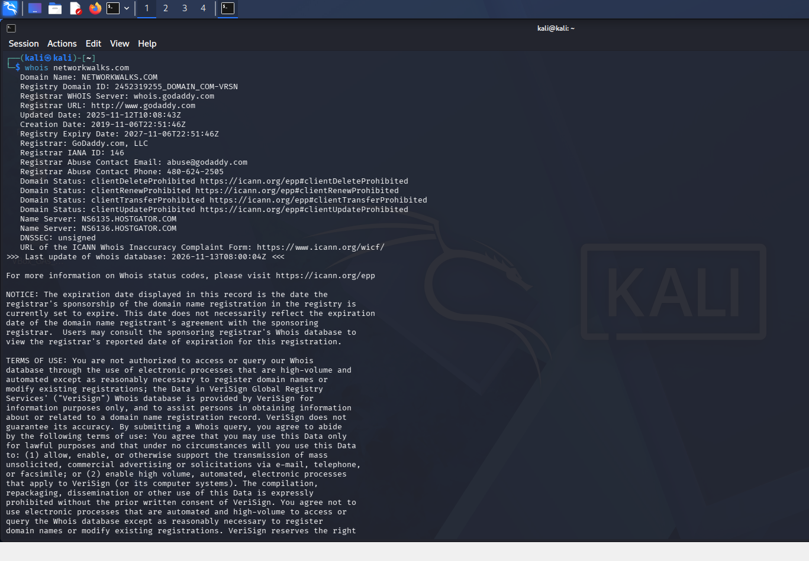
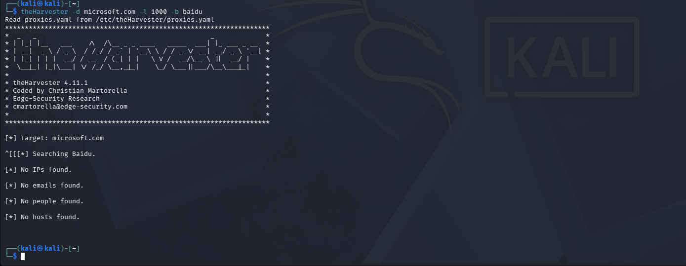
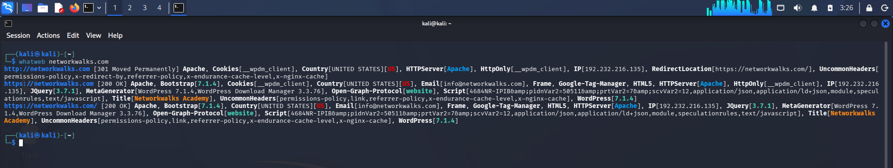
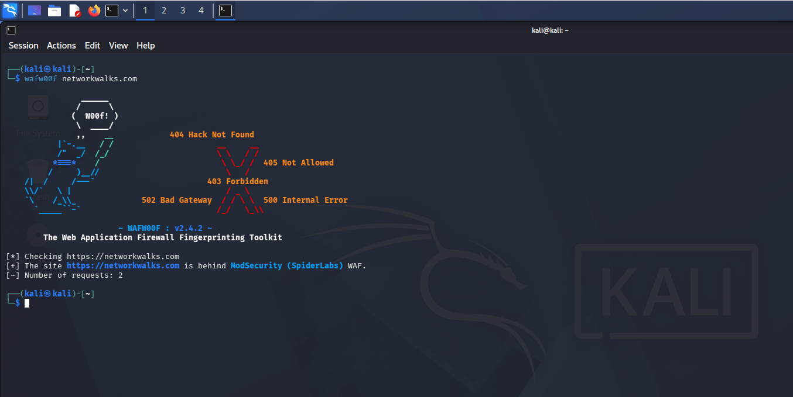
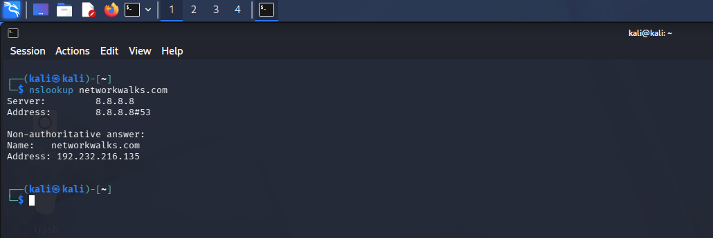

<div align="center">

# 🛰️ Footprinting & Reconnaissance

### A practical cybersecurity reconnaissance lab by Networkwalks

<a href="https://github.com/TrapGeek571/cybersecurity-footprinting-recon">
  
</a>

<br />


</div>

---

## ✨ Project snapshot

This lab explores how publicly available information can reveal an organisation's digital footprint. The exercises combine visual link analysis, DNS and email discovery, web fingerprinting, and network mapping—all from a defensive, ethical-hacking perspective.

> **Defender's takeaway:** Every exposed record, subdomain, service, and technology detail can help an attacker build context. Reduce unnecessary exposure before it becomes an entry point.

<div align="center">

| 🔎 Recon stage | 🧰 Primary tools | 🎯 Outcome |
|:---:|:---:|:---:|
| **Visual mapping** | Maltego | Infrastructure relationships and DNS context |
| **Open-source discovery** | theHarvester | Public emails, hosts, and subdomains |
| **Network visibility** | Zenmap / Nmap | Live hosts, IPs, MAC addresses, and topology |
| **Web fingerprinting** | curl, DNSRecon, WHOIS, WhatWeb, wafw00f | Public-facing technology and service clues |

</div>

## 🧪 What I did

<details open>
<summary><strong>01 · Maltego — visual link analysis</strong></summary>
<br />

- Created a domain entity for `networkwalks.com`.
- Ran DNS transforms to identify IP addresses, DNS names, and related infrastructure.
- Visualised the footprint as an investigation graph.

</details>

<details open>
<summary><strong>02 · theHarvester — open-source intelligence</strong></summary>
<br />

```bash
theHarvester -d microsoft.com -l 1000 -b baidu
theHarvester -d microsoft.com -l 50 -b all
```

Collected publicly indexed emails, subdomains, and hosts from multiple sources.

</details>

<details open>
<summary><strong>03 · Zenmap / Nmap — network discovery</strong></summary>
<br />

- Identified the local IP address and subnet with `ipconfig`.
- Ran a ping scan to find live hosts on the local network.
- Recorded discovered IP and MAC addresses.
- Exported the resulting topology as a PDF report.

</details>

## 🖼️ Evidence gallery

The gallery uses the repository's original assets and fixed-width HTML sizing so screenshots remain readable without overwhelming the page.

<div align="center">

<table>
<tr>
<td align="center" width="50%"><strong>WHOIS lookup</strong><br /><br /></td>
<td align="center" width="50%"><strong>theHarvester output</strong><br /><br /></td>
</tr>
<tr>
<td align="center" width="50%"><strong>DNSRecon results</strong><br /><br /></td>
<td align="center" width="50%"><strong>Web server fingerprinting</strong><br /><br /></td>
</tr>
<tr>
<td align="center" width="50%"><strong>WAF detection</strong><br /><br /></td>
<td align="center" width="50%"><strong>HTTP headers</strong><br /><br /></td>
</tr>
<tr>
<td align="center" width="50%"><strong>NSLookup</strong><br /><br /></td>
<td align="center" width="50%"><strong>Network topology report</strong><br /><br /><a href="assets/.pdf"></a><br /><br /><sub>Zenmap topology export · click to view or download</sub></td>
</tr>
</table>

</div>

## 📄 Penetration testing report

[View the penetration testing report (PDF)](./PENETRATION%20TESTING%20REPORT_Alvin-Supeeti.pdf)

## 🧠 Key learning

Footprinting is often passive reconnaissance: an attacker can build a surprisingly detailed picture without directly touching the target. For defenders, that means auditing public DNS, email exposure, subdomains, headers, technologies, and network metadata should be part of routine security hygiene.

## ⚖️ Responsible-use note

All techniques in this repository are intended for **authorised labs, owned systems, and educational practice only**. Never scan, enumerate, or collect information from systems without explicit permission.

<div align="center">

**Built while learning how small public clues become a complete attack-surface map.**

</div>
